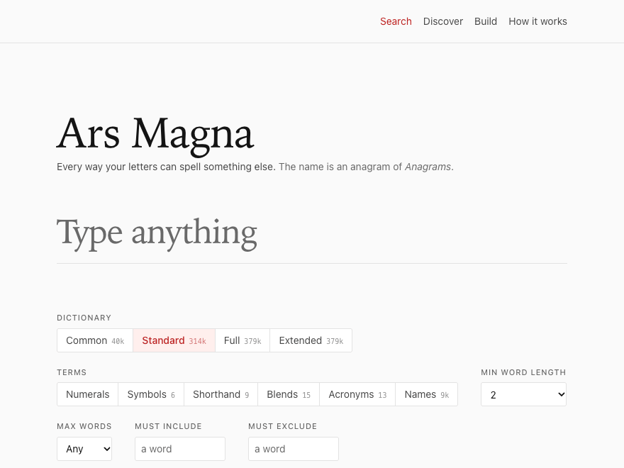

# Ars Magna

**Ars Magna** is an anagram of **Anagrams**. It is also Latin for *the great art*.

**<https://ars-magna.pages.dev>**



Give the site any text, and it returns every way those exact letters can be rearranged into real English words. Spaces move freely, every letter is used exactly once, nothing is added, and nothing is dropped. The exact count comes first, even when it runs into the millions.

The search uses no AI: it is deterministic, and it is checked against a brute-force search on known cases. It runs in your browser, so after one visit it works with no network at all.

The site has four pages:

- **Search** lists every anagram of a text, with filters, sorting, and exports.
- **Discover** collects anagrams worth keeping: names, companies, products, titles, places, and phrases rearranged into something that says something about them.
- **Build** checks an anagram you made by hand and sets the two sides against each other.
- **How it works** explains how Discover is curated, what a vote stores, and the dictionary rules.

## Input

Accented letters are folded to their base letter, so *Beyoncé* has three e’s and *Björk* is searched as *bjork*. The same goes for ß (ss), æ (ae), and ø (o). The dictionary is folded the same way, so the two always agree.

Punctuation is ignored. Spaces are ignored too, except that they tell the search where the text’s own words are. The text itself is never listed as its own anagram (see Filtering and sorting).

```
dormitory   →  dirty room
astronomer  →  moon starer
anagrams    →  ars magna
```

Nothing you type is replaced by something else. A number is never read as its name, and a symbol is never read as a letter or a word (the literal rule). A digit, or one of the symbols `@ $ & % + #` (and `!` or `?` inside a word), is a character of the text like a letter, and an anagram uses it as itself.

The line under the field counts the characters and says how each one stands, such as *1 as itself*. It also holds the control that reads a character as one of its letters (*$ as itself or s*, the default for `$ ! @`) or leaves it out.

No word has a digit, so a text with one has no anagram made of words alone. The page says which characters nothing uses, then counts again with the term classes that could use them: *0 anagrams with known words · 16 with numerals, shorthand or blends · Show them*. The **Terms** control beside the dictionary picker turns a class on: numerals, symbols, shorthand, blends, acronyms, or names. The address carries the classes that are on (`c=`, `l=`). Words alone is the default.

Letters of other scripts and other symbols are skipped, and the line says how many. The search is English only. A text with more than 127 copies of one letter is refused with a message, since letter counts are bytes. The reading table is `scripts/readings.json`, which the Rust engine and the TypeScript package both read.

## Dictionary

Word validity is judged against the [English OpenList](https://huggingface.co/datasets/ryanjosephkamp/english-openlist), pinned to one revision so results are reproducible. On top of it are a short public list of words this site has added, and its listed forms: the contractions whose letters the search knows. Four nested tiers are available in the UI:

| Tier | Words | What it is |
|---|---|---|
| Common | 39,986 | Everyday vocabulary: the 40,000 most frequent words, plus a curated set of two-letter words and the listed forms |
| **Standard** (default) | 314,042 | Every attested word, plus the listed forms |
| Full | 378,879 | The English OpenList at the pinned revision, plus the listed forms |
| Extended | 378,881 | The pinned list plus the site’s own additions |

Standard is the list minus the 64,837 entries that the source data generated by rule (`abacteremicer`, `nonlivabler`), which would otherwise flood results with words nobody recognizes. It is not Common plus a list cut at 15 letters, which would leave almost every longer word out of the default tier. Nothing is removed from the English OpenList itself. Full still carries every word, and expanding a result says where each word came from.

Extended adds the site’s own words. Each one is a line in `data/vocabulary/additions.jsonl` with a meaning and a source, `pnpm vocab:check` keeps the file honest in CI, and the word panel labels such a word as a site addition. The vocabulary the site searches (its additions, listed forms, and term classes) is published as the Hugging Face dataset [ars-magna-vocabulary](https://huggingface.co/datasets/ryanjosephkamp/ars-magna-vocabulary).

Apostrophes, hyphens, and punctuation carry no letters: they are dropped from a text, never required in an anagram, and shown only inside a listed form. A form is a spelling with an apostrophe or hyphen whose letters are one word, such as `it's` for `its` and `don't` for `dont`. Forms are listed in `data/vocabulary/forms.jsonl` with a meaning and a source. Where the letters are already a word, the form adds a spelling that the word panel lists beside the word. Where they are not (`dont`, 35 of the 53 forms), the letters join every tier, since a contraction is everyday English, and the row shows `don't` with its apostrophe. Possessives are never listed.

The dictionary artifact keeps the forms in a section of their own, beside the letters-only word list, so the search engine never sees an apostrophe. Results, promotion keys, and hit ids carry the letters alone.

Beside the words are the term classes: `symbols.jsonl`, `shorthand.jsonl`, `blends.jsonl`, and `acronyms.jsonl` in `data/vocabulary/`, plus the names list as the names class (three letters or more). Each term has what it reads as, a meaning, and a public source (`&` and, `u` you, `b8` bait, `btw`). `pnpm vocab:term` proposes one, and `pnpm vocab:check` holds the files to their rules; for example, a term is never a word of the dictionary, since `lol` and `faq` are words already. `dict:build` emits the classes as an artifact beside the word list. A search admits a class by naming it (the Terms control on the site, `--classes=shorthand,blends` on the command line). A term that is not a word is underlined on its row, and the word panel gives its class, what it reads as, its meaning, and its source.

## Definitions

The English OpenList carries no definitions, so glosses come from [WordNet 3.1](https://wordnet.princeton.edu/). It covers 119,630 words (31.6% of the list). A little over half of those are reached through WordNet’s own morphology, so `dormitories` gets `dormitory`’s definition and says that it did. Words with no gloss fall back to explaining their provenance.

## Export

Any result set can be downloaded as TXT (one anagram per line), JSON (the same list with the query and filters attached, words kept as arrays so the spacing survives), CSV (with word count and longest word, for sorting in a spreadsheet), or a ZIP of all three plus a README.

Exports are capped at 100,000 rows. A query can have over a hundred billion answers (*The United States of America* has 116,576,660,306), and writing them all would take terabytes. JSON and CSV both carry a `complete` flag and say what they left out, because a file that has been emailed on has lost the interface that produced it and has to disclose that itself.

## Filtering and sorting

The result list can be filtered by substring and sorted by word count, alphabetically, or by longest word. Both act on what has been loaded, not on the whole answer space, since sorting results the engine never enumerated can’t be done. The status line says which it is, and offers to load everything when the total is small enough for that to be honest. A filter that is one or more dictionary words is counted across every result instead, with those words as Must include, so the line leads with the whole answer: `11 of 15,202 contain “shamed”`. *Show them*, or Enter in the filter box, switches the list to them. Nothing switches it while you type.

Must exclude works the other way, in the engine rather than on the loaded rows: it takes a word out of the dictionary for that one search. A class of anagrams whose every spelling is excluded drops out, and one with other spellings keeps them and hides the excluded one, so the count is still exact. A word can’t be in Must include and Must exclude at once.

The text itself is never one of its own anagrams: its words, in any order. A row of the list stands for every spelling of the same letters and shows the commonest, so without this rule *below* would lead its own list and hide *elbow* behind it. Where another word shares a word’s letters, the text’s own row is shown with that word instead (*below* appears as *elbow*, *apple house* as *appel house*), and the count is what it was. Where none does (*dormitory*, *house*), the row is left out, the count is one fewer, and the page says so beside it: *dormitory* has 115, not 116. The same letters spaced differently are an anagram, so *applesauce* is a result of *apple sauce*. The engine does this, so the count, Go to, Surprise me, paging, and every export agree, and JSON, CSV, and the ZIP’s README carry a `textLeftOut` flag or sentence.

## Discover

`/hits` is a collection of anagrams worth keeping, in three sections: Greatest Hits, Interesting, and A stretch. Each card gives the text, its anagram, and one sentence on why the two fit. The page can be filtered by category, ordered by votes, by date, or alphabetically, and searched, and one card a day leads it. A search whose text has cards on Discover shows them above its results, and every card links to its own page.

Readers can vote for a card, promote an anagram from a search result, or submit one from Build for review. Each goes through a Cloudflare Turnstile check and is stored in a D1 database by the site’s `/api/` functions. Pressing again takes a vote or a promotion back.

The collection lives in `data/hits.jsonl` and is published as the Hugging Face dataset [ars-magna-greatest-hits](https://huggingface.co/datasets/ryanjosephkamp/ars-magna-greatest-hits).

### Curating Discover

New cards come from a pipeline in `tools/hits` that runs in stages, each with its own command:

1. `pnpm hits:fetch` takes Wikipedia’s most-viewed pages of the day as candidate inputs.
2. `pnpm hits:enumerate` lists their anagrams with the Rust engine, and `pnpm hits:prefilter` drops the ones the rules rule out. `pnpm hits:screen` writes what is left as screen inputs in `data/queue/<date>/`.
3. A language model reads the screen inputs and keeps the phrases that link to their input. It then judges the kept phrases against a fixed rubric and writes a one-sentence justification for each. Guards in `tools/hits/src/guards.ts` refuse answers that look unread, such as a screen that keeps too many phrases for one input.
4. `pnpm hits:ingest` adds the verdicts to `data/hits.jsonl` as `proposed` cards, with a report, on a branch. Nothing is published until a person merges it.

Each card has one of four statuses: `proposed`, `accepted`, `featured` (Greatest Hits), or `retired`. A retired card stays in the file so the pipeline never proposes it again, but it is not published. `pnpm hits:set` changes a status; `hits:justify`, `hits:describe`, `hits:display`, and `hits:order` edit a card’s text; and `pnpm hits:desk` builds a page for reviewing cards.

Reader promotions and Build submissions follow the same rule. `pnpm promotions:export`, `promotions:review`, and `promotions:apply` carry them through a private review, and a person merges what is published. A submission can also arrive as a GitHub issue, which a workflow checks with the engine; `pnpm hits:ingest --from-issue=N` accepts one. A word the vocabulary lacks becomes a word request in `data/vocabulary/requests.jsonl`; accepting one is `pnpm vocab:add`, then `pnpm dict:build` and a merge. `pnpm hits:publish` builds the Hugging Face dataset.

The nightly workflow and the promotion export are switched off for now, so new cards are added and promotions are reviewed by hand with the commands above.

## Build

`/build` is for making an anagram by hand. Type a text and the letter tray lists its letters with their counts. Type an anagram and the tray counts down: a letter used too often turns red, and one line says what is wrong (`2 extra a · 1 missing t`). Tapping a letter in the tray adds it at the caret.

Two checks follow: *Letters match*, and *Words known*, which asks the same engine and dictionary as the search, at the tier you choose, and names each word it lacks. Both checks count the pool: an anagram of “Blink-182” has to use the 1, the 8, and the 2, and *Words known* names the class of each term that is not a word (`b8 is a blend`), with the same Terms control. When the letters match, the anagram can be submitted to Discover as a promotion with a category and an optional note, kept for review.

Beneath the boxes is an analysis of both sides, on one grid so each line sits level across the two:

- Letters, distinct letters, vowels, the rarest letters, and the letters used most.
- A bar per letter, darker the more the letter is used. Selecting a bar marks that letter everywhere on the page. A tick on each bar marks how many of that letter English would use in as many letters.
- Words, their average length, their lengths as bars, their parts of speech, and how common they are, in bands and word by word on a scale from rare to everyday.
- For the text alone, the number of anagrams it has in each of the four dictionaries (the chosen one first). Each is counted in its own worker for at most four seconds, and reads *more than* when time runs out first.
- For texts of up to 60 characters, a letter map that sets the text above the anagram with a fine line from each character to where it went, digits and symbols among them.
- With both boxes filled, the two side by side, with the ordering score each reads at and the words they share.

Both boxes live in the address (`/build#t=…&a=…`), so a check is a link. Every search result row, every Discover row, and the search toolbar link to Build with that row in place. *Export* writes the analysis as TXT or JSON. *Print* uses the browser’s own dialog (where Save as PDF lives) with a print stylesheet that keeps the boxes, the checks, and the figures and drops everything you can’t use on paper.

## Offline

Everything happens on your own machine: the search, the dictionary, and the definitions. After one visit, the site works with no network at all. A service worker serves the shell from cache, and the engine keeps the dictionary in Cache Storage. The page fills both on first load from a build-time `precache.json`, because a module worker’s own script request never reaches a service worker’s `fetch` handler and could not be cached any other way.

The definition shards are the exception. They are fetched per word on demand, so a word you have not looked at before shows no gloss offline.

## Keyboard

Arrow keys walk the result list, `Home` and `End` jump to either end, `PageUp` and `PageDown` move ten at a time, and `Enter` opens a result. The list is virtualized, so tabbing alone would run out after a screenful. The arrow keys move a cursor that scrolls the target into view and then focuses it.

## Command line and MCP server

The same engine runs natively from the command line:

```bash
cargo run --release -p anagram-cli -- solve "Clint Eastwood" --limit=10
cargo run --release -p anagram-cli -- count "William Shakespeare"
```

`solve` and `count` take the same options as the site (`--tier=`, `--classes=shorthand,blends`, `--leet='$!@'`, `--min-len=`, `--max-words=`). `check` tests a hand-made anagram.

`packages/mcp` is an MCP server over the same engine, with five tools: `solve`, `count`, `nth`, `explain_word`, and `propose_hit`. After `pnpm install && pnpm wasm:build`, `node packages/mcp/bin/ars-magna-mcp.js` starts it over stdio. Its own README has the Claude Code and Claude Desktop settings.

## Development

```bash
pnpm install
pnpm dict:fetch     # download pinned sources into .cache/ (~42 MB, once)
                    # the pinned OpenList revision is gone from the Hub; its word
                    # list and the facts file come from this repo's
                    # openlist-368bf0e4 release
pnpm dict:build     # emit apps/web/public/dict/ artifacts
pnpm dict:shards    # emit apps/web/public/defs/ definitions (~18 MB, committed)
pnpm wasm:build     # compile the Rust engine to WASM
pnpm dev
```

The dictionary artifacts and the definition shards (514 files, 18 MB) are both committed. They are deterministic output of pinned sources, and committing them means a deploy needs no download from Hugging Face, so publishing does not depend on a third party being up. Regenerate them with `pnpm dict:build` and `pnpm dict:shards` when a pin moves.

Requires Node 22+, pnpm, a Rust toolchain with the `wasm32-unknown-unknown` target, and [wasm-pack](https://github.com/drager/wasm-pack) 0.15 or later (`cargo install wasm-pack`), which `pnpm wasm:build` runs. Build the engine before the tests, the type check, or the site build.

```bash
pnpm test           # TypeScript tests
pnpm rust:test      # engine tests, including the completeness oracle
pnpm typecheck      # every TypeScript package
pnpm vocab:check    # the vocabulary files against their rules
pnpm build          # the WASM engine and the site, into apps/web/dist
```

`pnpm dev` serves the site without its `/api/` functions, so votes and promotions need Wrangler. Cloudflare’s published Turnstile test secret always passes, and the page uses the matching test site key on `localhost`:

```bash
pnpm build
cd apps/web
printf 'TURNSTILE_SECRET=1x0000000000000000000000000000000AA\nIP_HASH_SECRET=local\n' > .dev.vars
pnpm dlx wrangler@4.121.0 d1 migrations apply ars-magna-discoveries --local
pnpm dlx wrangler@4.121.0 pages dev dist      # http://localhost:8788
```

## Layout

```
crates/anagram-core    search, counting, unranking: pure Rust, no wasm deps
crates/anagram-wasm    wasm-bindgen shim
crates/anagram-cli     native binary for goldens and profiling
packages/engine        worker protocol, dictionary loading, WASM binding
packages/mcp           an MCP server over the engine: solve, count, nth, explain_word, propose_hit
tools/dict-build       pinned fetch, tiering, binary artifact emission
tools/hits             the Discover collection: candidates, checks, promotions, the dataset
apps/web               React UI
apps/web/functions     the /api/ functions for votes and promotions
apps/web/migrations    the D1 database schema
data/                  the Discover collection, the vocabulary files, daily vote counts
scripts/readings.json  how digits and symbols read, shared by Rust and TypeScript
docs/                  the demo GIF at the top of this file
.github/workflows/     CI, deploy, dataset publishing, and submission checks
```

## Contributing

Found a good anagram? Promote it from a search result, submit it from [Build](https://ars-magna.pages.dev/build), or open the “Submit an anagram” issue form on GitHub. A check runs automatically, and a person decides whether it goes in. A word the dictionary lacks can be requested the same way.

Bugs go in GitHub issues. To report a security problem, use the repository’s private vulnerability reporting (the Security tab) instead of a public issue.

## Deploying

CI runs on pull requests, and on pushes to `main` that change more than the daily data files. The deploy workflow publishes `main` to Cloudflare Pages, project `ars-magna`, at <https://ars-magna.pages.dev>, when it is run by hand. It skips, rather than failing, when the project variable below is unset.

The workflows:

- **CI** runs the tests on pull requests and pushes to `main`.
- **Deploy** publishes the site. It runs by hand only.
- **Publish hits** and **Publish vocabulary** update the two Hugging Face datasets when their files change on `main`.
- **Validate submission** checks an anagram submitted as a GitHub issue.
- **Hits nightly** and **Export promotions** are switched off.

The build happens in GitHub Actions rather than in Cloudflare’s build image, so the Rust toolchain is under the project’s control. The dictionary artifacts and definition shards are committed, so no build step reaches Hugging Face.

To set it up on a fork:

1. In the Cloudflare dashboard, create a **Pages** project (Workers & Pages → Create → Pages). Use *Direct Upload*: the repo does not need to be connected, since Actions does the building. Note the project name.
2. Create an API token (My Profile → API Tokens → Create Token) with the **Cloudflare Pages: Edit** and **D1: Edit** permissions. Copy your Account ID from the dashboard sidebar.
3. Add them to your repo. These commands prompt for the values, so the secrets are never typed into a shell history or a chat window:
   ```bash
   gh secret set CLOUDFLARE_API_TOKEN
   gh secret set CLOUDFLARE_ACCOUNT_ID
   ```
4. Name the project. This variable is the on switch: setting it makes the deploy workflow start running.
   ```bash
   gh variable set CLOUDFLARE_PROJECT_NAME --body ars-magna
   ```
5. Set up votes and promotions:
   - Create the database with `pnpm dlx wrangler d1 create ars-magna-discoveries`, and put its id in `apps/web/wrangler.toml`. Each deploy applies the migrations in `apps/web/migrations` before it uploads the site.
   - Create a Turnstile widget for the site’s hostname, and put its site key in `apps/web/src/votes/state.ts`.
   - In the Pages project’s settings, add two secrets: `TURNSTILE_SECRET`, the widget’s secret key, and `IP_HASH_SECRET`, any long random string (`openssl rand -hex 32`). `VOTES_OPEN` and `PROMOTIONS_OPEN` in `wrangler.toml` turn each off.
6. Trigger the first deploy:
   ```bash
   gh workflow run Deploy
   ```

### How the dictionary gets compressed

Cloudflare compresses by content type and does not compress `application/octet-stream`, so the dictionary would cross the wire at full size. The current build is **3,175,719 bytes uncompressed against 890,391 with brotli** across the three artifacts (the word list, the tiers, and the term classes), a 3.6× difference on every first visit.

Pages will not negotiate between sibling files, so the `.br` artifacts that `dict:build` produces are served under their own URLs with an explicit `Content-Encoding: br` in `_headers`, and the engine asks for `<name>.br` first.

That header is the fragile part. Without it, the browser hands the engine raw brotli and nothing raises an error: the bytes just fail to parse somewhere inside Rust. So the engine checks the decoded length against `bytes` in the manifest and falls back to the plain artifact if it does not match. This is not hypothetical: a client that sends `Accept-Encoding: identity` gets exactly that response from Pages today.

To confirm compression is live:

```bash
curl -sI -H 'Accept-Encoding: br' https://<your-site>/dict/manifest.json
```

Then fetch the `.br` sibling of the artifact named in that manifest and check for `content-encoding: br`. If it is missing, the site still works, just at three and a half times the transfer.

One trap if you edit `_headers`: Pages applies **every** matching rule and appends their values rather than picking the most specific. Two rules that both match a path yield a concatenated `Cache-Control`, and a stray `immutable` in the tail is not cancelled by an earlier `max-age`. That is why the artifact rules are written per extension instead of `/dict/*`, which would also match `manifest.json`.

## License

The code is MIT; see <LICENSE>. The data comes from other sources under their own terms, set out in full in <THIRD-PARTY-NOTICES.md>:

- **Words:** the [English OpenList](https://huggingface.co/datasets/ryanjosephkamp/english-openlist). Its maintainer's own contribution is MIT; the sources it was assembled from keep their own terms, which the dataset's card names.
- **Frequencies:** [hermitdave/FrequencyWords](https://github.com/hermitdave/FrequencyWords) (OpenSubtitles 2018), whose content is under [CC BY-SA 4.0](https://creativecommons.org/licenses/by-sa/4.0/). The frequency bytes and the Common tier in `apps/web/public/dict/` are adapted from it and offered under CC BY-SA 4.0.
- **Definitions:** derived from Princeton WordNet 3.1, under its own license.
- **Names:** [GeoNames](https://www.geonames.org/) ([CC BY 4.0](https://creativecommons.org/licenses/by/4.0/)), [Wikidata](https://www.wikidata.org/) (CC0), and US Census Bureau name files.
